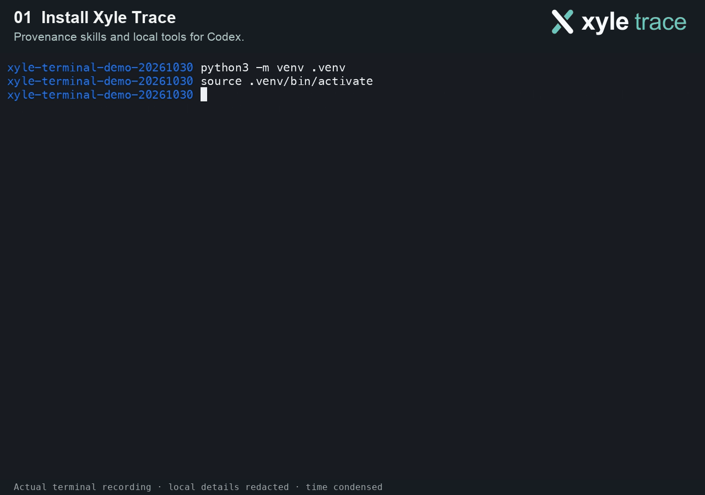

<h1 id="xyle-trace">
  <picture>
    <source media="(prefers-color-scheme: dark)" srcset="src/xyle_trace/assets/brand/logo-dark.svg">
    
  </picture>
</h1>

**Know where your agent’s results came from.**

Provenance skills and local tools for **Claude Code and Codex**. Your coding
agent records sources, evidence and calculations as it works, so “where did
this number come from?” has an inspectable answer.

[](https://github.com/xyle-labs/xyle-trace/actions/workflows/ci.yml)

[Quickstart](docs/quickstart.md) · [Agent setup](docs/agent-setup.md) ·
[Real example](docs/examples/assembly-density/README.md) · [Core contract](docs/core-contract.md)



*34-second silent recording: install → prompt → capture → calculate → inspect.
Time condensed; local machine details redacted.*

The [real-data example](docs/examples/assembly-density/README.md) compares three
German cities’ published assembly listings per 100,000 residents. Explore the
[map](docs/examples/assembly-density/map.svg),
[source graph](docs/examples/assembly-density/source-graph.svg) and
[reviewed aggregate results](docs/examples/assembly-density/summary.json).

## Get started

Requires **Python 3.11+ and Git**. Use a project virtual environment. Until the
first PyPI release, install from the public repository:

```bash
python -m pip install 'xyle-trace[mcp] @ git+https://github.com/xyle-labs/xyle-trace.git@main'
xyle-trace new --project demo --path ./demo --host codex
cd demo
codex
```

For Claude Code, use `--host claude` and start `claude`; `--host both` installs
configuration for both hosts. `main` tracks unreleased development: use a
reviewed commit ID for a repeatable installation.

`new` creates the local store, five skills, MCP configuration, project guidance
and a starting `contracts.yaml`. Configure that policy for your actual input
datasets before analytical work, then ask your agent to use Xyle Trace to track
sources, calculations and the resulting claims.

Want a complete worked calculation first?

```bash
xyle-trace demo --project demo --path ./worked-demo
```

Open `worked-demo/lineage.html`. This synthetic example includes a correction,
a blocked current-data run and a verified historical replay. The
[quickstart](docs/quickstart.md) walks through the actual output.

## What it keeps

| Question | Recorded trail |
| --- | --- |
| Where did this value come from? | Source versions, located evidence and dataset records |
| Were the inputs backed? | Explicit contracts and pre-computation evidence gates |
| How was this result calculated? | Transformations, inputs, parameters, run outcomes and output hashes |
| Can this calculation be repeated? | Retained code and concrete inputs for supported local runs, with matching replay checks |
| What changes if a source changes? | Upstream explanations, downstream impact and claims needing review |

Five skills guide the workflow; an eight-tool MCP server, typed Python service
and CLI record the material the agent submits. The local SQLite graph and
retained files need no hosted storage service. Your agent host receives the data
returned through MCP; its privacy settings and model processing still apply.

## Inspect a result

Use an artifact ID returned by your agent or the worked demo:

```bash
xyle-trace explain --project demo --db ./worked-demo/.lineage/graph.db \
  --node ARTIFACT_ID
```

Replace `ARTIFACT_ID` with that returned ID. The explanation traces the artifact
through its run, transformation, dataset, evidence link and captured source.
See the [quickstart](docs/quickstart.md) for the worked workflow.
Selected reports and offline views make those connections readable. Portable
handoffs can preserve the graph and retained evidence without restoring
executable working files.

## Documentation

| Start here | Go deeper |
| --- | --- |
| [Quickstart](docs/quickstart.md) | [Execution and retained replay](docs/execution.md) |
| [Claude Code / Codex setup](docs/agent-setup.md) | [Capture, review and sharing](docs/workflow.md) |
| [Real-data example](docs/examples/assembly-density/README.md) | [Core contract and limitations](docs/core-contract.md) |
| [Product concept](docs/concept.md) | [Roadmap](ROADMAP.md) |

## Limits

Trace records what the agent submits; it cannot detect an unreported source.
Captured bytes and valid locators do not prove factual accuracy or semantic
support for a claim.

- MCP `record_run` is **reported** capture and is never reproducible. Only
  `xyle-trace-run` executes and verifies retained local calculations.
- The retained runner supports trusted, self-contained standard-library
  Python/JSON programs. It is a replay contract, not an OS sandbox or a
  distributable environment image.
- `verified_locator` checks an anchor against the captured bytes. A binary
  source without a text layer remains unverifiable under that check.
- Node IDs depend on the project ID; choose the project name deliberately.
- Live agent adherence depends on the host and task. See the
  [observed host findings](docs/agent-acceptance.md) and
  [full contract](docs/core-contract.md) for the practical limits.

Domain workloads belong in separate consuming projects. The published example
contains reviewed aggregates and selected paths; raw source captures, agent
logs and retained stores stay outside this repository.

## License

Apache-2.0. See [LICENSE](LICENSE) and [NOTICE](NOTICE). Third-party example data
attributions are listed with the [example](docs/examples/assembly-density/README.md#coverage-and-attribution).

[Logo and brand assets](docs/branding.md).

Project contact: [jesse@xyle.de](mailto:jesse@xyle.de).
