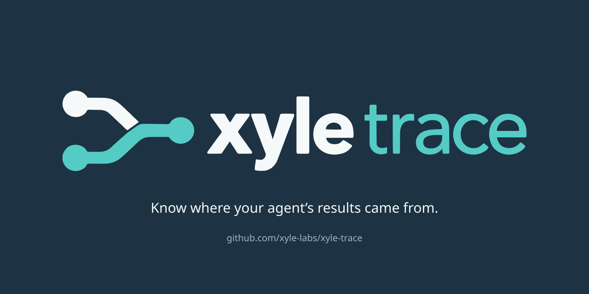

# Xyle Trace brand assets

The approved identity shows two source paths converging toward one result.
These SVG masters preserve that artwork, with solid Xyle colours and outlined
lettering. The logo and mark need no fonts, embedded bitmaps, scripts or remote
resources. The social card adds ordinary system-font text.

## Logo and mark

| Asset | Use |
| --- | --- |
| [Logo](../src/xyle_trace/assets/brand/logo.svg) | Light backgrounds; README and report headers |
| [Inverse logo](../src/xyle_trace/assets/brand/logo-dark.svg) | Dark backgrounds |
| [Square icon PNG](../.github/assets/brand/icon-square.png) | 512 × 512 upload for avatars and app icons |
| [Square icon SVG](../src/xyle_trace/assets/brand/icon-square.svg) | Scalable square icon with navy background |
| [Compact mark](../src/xyle_trace/assets/brand/mark.svg) | Small UI, icons and avatars |
| [Inverse mark](../src/xyle_trace/assets/brand/mark-dark.svg) | Compact uses on dark surfaces |
| [Monochrome mark](../src/xyle_trace/assets/brand/mark-mono.svg) | Inline SVG that inherits `currentColor` |
| [Adaptive favicon](../src/xyle_trace/assets/brand/favicon.svg) | Browser tabs, with light/dark colour adaptation |
| [Social preview source](../src/xyle_trace/assets/brand/social-preview.svg) | Editable 1280 × 640 social card |

## Colour and placement

| Colour | Value |
| --- | --- |
| Slate navy | `#1d3242` |
| Deep teal | `#126e70` |
| Inverse lettering | `#f5f9f9` |
| Inverse teal | `#55cbc5` |

Keep the original aspect ratio and leave clear space around the artwork. Use the
wordmark when the product name matters and the compact mark when space is limited.
The inverse artwork has identical geometry with colours chosen for a dark surface.

The README and example page select the matching logo for the reader's colour
scheme. Selected HTML reports and the offline explorer embed the logo and favicon
from the installed package: their branding continues to work offline and when a
single exported HTML file is shared. Titles, selected data and provenance remain
independent of the branding.

The example figures carry the same logo. Demo branding stays in the editorial
header area, outside the recorded terminal content. The source observations,
calculation, values and recorded tool activity remain unchanged.

The artwork began as an approved image-generated concept. The SVGs are the
production masters, with the raster texture removed and glyphs converted to paths.
They do not add a runtime design-tool dependency.

## Square icon and favicon

Use the square PNG for avatar uploads. It contains only the approved symbol,
with a navy background and padding that accommodates circular crops. The SVG
source scales to other app-icon sizes. The adaptive SVG favicon is already
embedded in Trace's exported HTML pages.

GitHub's [organization profile settings](https://docs.github.com/en/organizations/collaborating-with-groups-in-organizations/customizing-your-organizations-profile#changing-your-organizations-profile-picture)
control the organization avatar shared across its repositories. An upload there
would change the Xyle Labs identity across projects; this PR provides the Trace
asset without changing that setting.

## GitHub social preview

The [ready-to-upload PNG](../.github/assets/brand/social-preview.png) is 1280 × 640
with a solid navy background. After merging, upload it under repository **Settings
→ Social preview → Edit**, following [GitHub's instructions](https://docs.github.com/en/repositories/managing-your-repositorys-settings-and-features/customizing-your-repository/customizing-your-repositorys-social-media-preview).
Committing the card does not change that repository setting automatically.

## Publication review

The SVG masters contain only vector shapes, accessible labels and local styles.
There are no embedded bitmaps, external resources, private paths or design-tool
metadata. The square PNG contains only the approved symbol on navy, with
resolution metadata only, and was inspected at 512 px and 32 px. The social PNG
contains only the logo, existing project tagline and
public repository address, with resolution metadata only. It was visually
inspected and its visible text was scanned alongside the refreshed demo. Exact binary hashes and
sizes are pinned in `scripts/check_repo.py`; other binary files remain blocked.
The [example publication review](examples/assembly-density/PUBLICATION.md)
documents the full recording review.

Reviewed social PNG: 38,226 bytes. SHA-256:
`9726ce029bfb4670f96cb21e61858daa624c103886b2808c1febbb7416389727`.

Reviewed square PNG: 9,013 bytes. SHA-256:
`5406bf16cada05a062a06d2cf5a1d1aa80784e354d8d8fb109e1a05bd514dcf1`.
