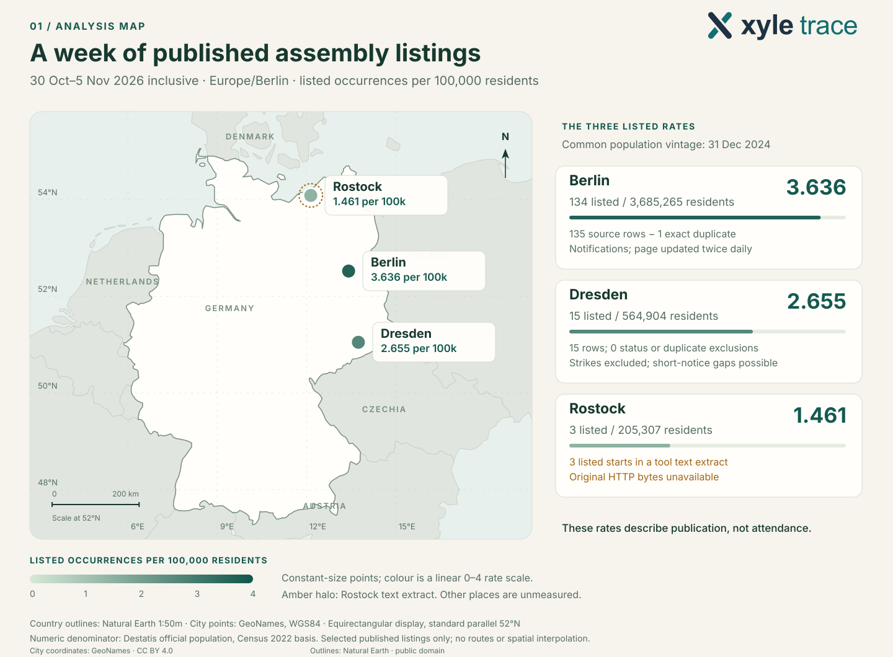
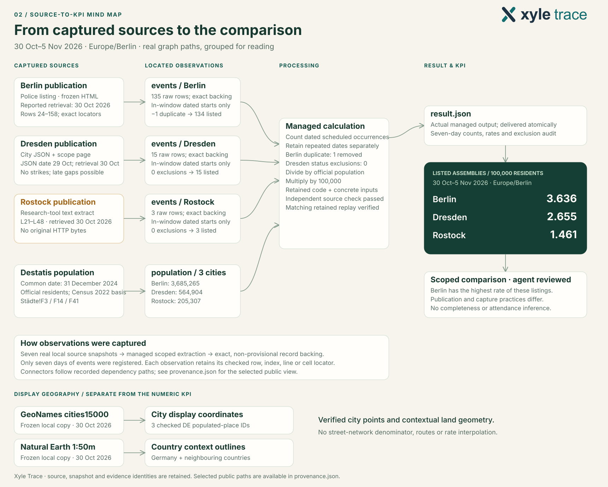

# Real example: from assembly listings to a source-backed map

Codex compares published planned assembly occurrences in **Berlin, Dresden and
Rostock**, 30 October–5 November 2026, using Xyle Trace to keep the source-to-result
connections. This is a frozen, selected-city example, not a live protest tracker.

[Watch the recorded workflow](../../../.github/assets/codex-workflow.gif) ·
[Map](map.svg) · [Source graph](source-graph.svg) · [Aggregate results](summary.json)

## The prompt

> Use Xyle Trace to compare planned assemblies per 100k residents in Berlin,
> Dresden and Rostock, 30 Oct–5 Nov 2026. Build a map and a source-to-KPI graph.
> Follow case-brief.txt.

A [publication-safe workflow brief](case-brief.txt) and the recorded core
[evidence policy](contracts.yaml) are included for adapting the workflow in a
separate consuming project. The public brief omits host-session instructions;
it is not a byte-for-byte copy of the original brief. Use an explicit current
window and your own approved source versions for a new study.

The recording uses this actual prompt. Preparation supplied frozen public source
files, the date window and evidence policy in a separate consuming project.
Its Trace store initially contained only the project node; no extracted counts,
rates or finished results were supplied.

## What happens

1. Install Trace and scaffold the Codex project with its five skills and MCP tools.
2. Codex captures seven source versions and links the observations to exact evidence.
3. Evidence validation precedes the managed calculation. A retained replay matches
   the numeric output; an independent source parser checks counts and rates.
4. Codex creates the map and a focused graph of real recorded paths. The 21
   projected paths were checked against the recorded graph, including typed
   snapshot references and record evidence resolutions.

The GIF contains genuine shell and native Codex terminal output. Setup and
analysis were recorded in separate takes. Time is condensed; local paths,
unrelated tool connections and runtime footers are redacted or cropped.

## The result

| City | Included occurrences | Official residents | Occurrences / 100,000 |
| --- | ---: | ---: | ---: |
| Berlin | 134 | 3,685,265 | 3.636 |
| Dresden | 15 | 564,904 | 2.655 |
| Rostock | 3 | 205,307 | 1.461 |

The common population vintage is **31 December 2024** (Destatis, Census 2022
basis). One exact duplicate was excluded in Berlin. The numerator counts dated
scheduled occurrences, not participants or attendance.





## Inspect the public files

- [summary.json](summary.json): city aggregates, daily totals, population,
  exclusions, rates and source limitations. This is a publication view, not the
  original retained result artifact.
- [sources.json](sources.json): the seven original publication/download URLs,
  capture representations and source-byte hashes. The named input files are
  references to the original private capture, not bundled downloads.
- [provenance.json](provenance.json): selected original node IDs and the real
  dependency paths behind the diagram. Record payloads, execution environments
  and the retained replay store are omitted.
- [Publication review](PUBLICATION.md): what was reviewed, redacted and excluded.

Check the arithmetic from the published aggregates with the standard library,
from the repository root:

```bash
python - <<'PY'
import json
from pathlib import Path

data = json.loads(Path("docs/examples/assembly-density/summary.json").read_text())
for city in data["cities"]:
    rate = city["listed_assemblies"] / city["population"] * 100_000
    assert abs(rate - city["per_100k"]) < 1e-12
    print(f"{city['city']}: {rate:.3f} per 100,000")
PY
```

This checks the published ratios. The original source extraction and retained
replay require the private captured bytes and execution bundle. For a complete
installed-package example with retained replay, run
`xyle-trace demo --project demo --path ./worked-demo`; see the
[quickstart](../../quickstart.md).

## Coverage and attribution

These are rates in the captured published listings. Berlin's list changes over
time. Dresden excludes strikes and can omit short-notice assemblies. Rostock
uses a lower-fidelity research-tool text extract; original HTTP response bytes
were unavailable. Missing activity is unknown, not zero. A separately retrieved
Rostock extract during earlier research differed; this example consistently uses
the identified frozen three-occurrence version and makes no publisher-update claim.

City coordinates are from [GeoNames](https://www.geonames.org/), under
[CC BY 4.0](https://creativecommons.org/licenses/by/4.0/). Country outlines are
from [Natural Earth](https://www.naturalearthdata.com/), whose
[map data are public domain](https://www.naturalearthdata.com/about/terms-of-use/).
The map is a derived display of those sources; city labels, colours and rates
were added for this analysis. Areas outside the three city points are unmeasured;
there is no spatial interpolation or street-network denominator.

Numeric references are the original Berlin Police, City of Dresden, City of
Rostock and Destatis publications linked in [sources.json](sources.json).
Their source bodies, workbooks and individual assembly records are not
redistributed here. Original publisher terms continue to apply.
